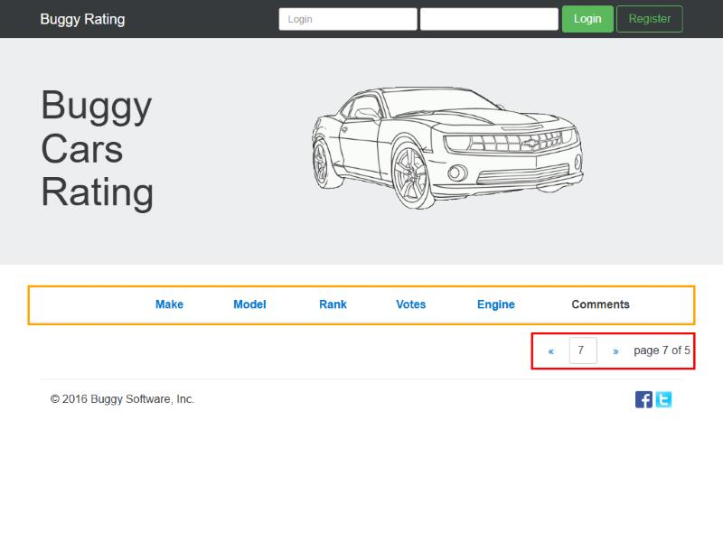
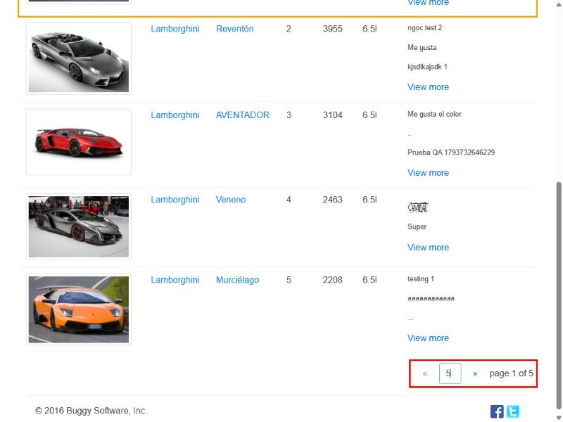
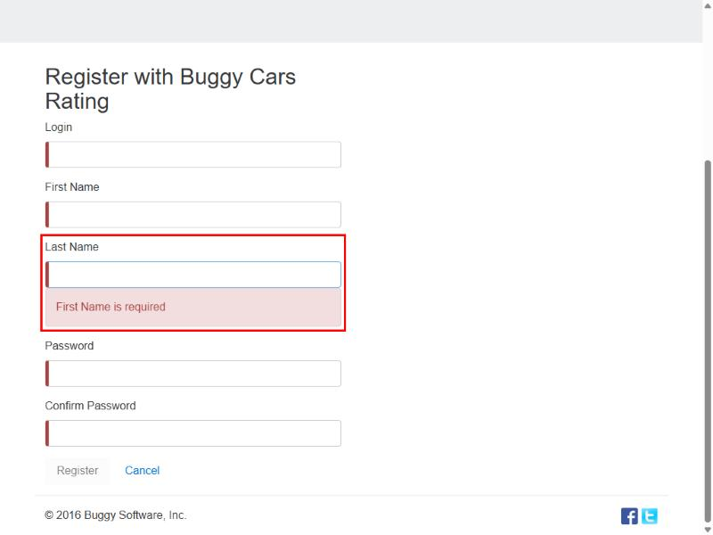
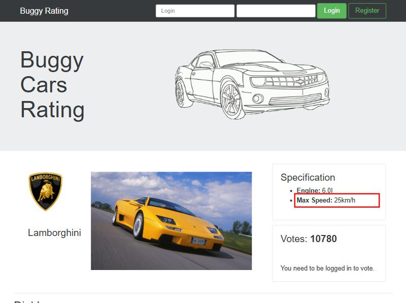
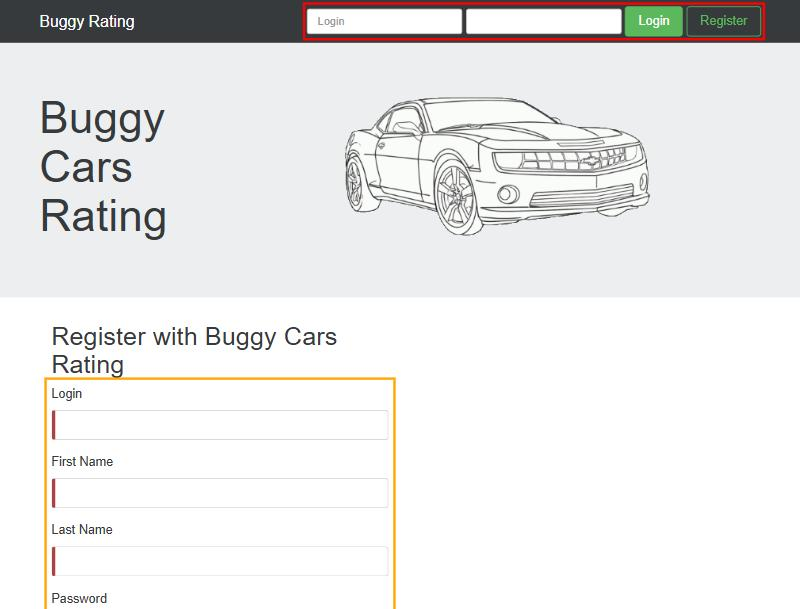

# Bugs encontrados en Buggy Cars Rating

Sitio: https://buggy.justtestit.org/ (sitio de práctica con errores intencionales).

**Criterio:** solo se reportan bugs **observados y reproducidos al menos 2 veces**, con evidencia. Cada reporte está escrito para que lo entienda **cualquier persona** que reciba el ticket: el **resumen en simple** es para alguien no técnico y el **detalle técnico**, para desarrollo.

**Severidad** (impacto técnico): Crítica · Alta · Media · Baja. **Prioridad** (urgencia de negocio): Alta · Media · Baja. Son independientes: un bug puede tener severidad baja y prioridad alta.

## Resumen

| Id                                                                                                        | Bug                                                                                    | Tipo                       | Severidad | Prioridad |
| --------------------------------------------------------------------------------------------------------- | -------------------------------------------------------------------------------------- | -------------------------- | --------- | --------- |
| [BUG-01](#bug-01--el-paginador-del-ranking-deja-avanzar-más-allá-de-la-última-página)                     | El paginador del ranking deja avanzar más allá de la última página                     | Funcional (valores límite) | Media     | Media     |
| [BUG-02](#bug-02--escribir-la-primera-o-la-última-página-en-el-paginador-no-navega)                       | Escribir la primera o la última página en el paginador no navega                       | Funcional (valores límite) | Media     | Media     |
| [BUG-03](#bug-03--el-campo-last-name-muestra-el-error-first-name-is-required)                             | El campo "Last Name" muestra el error "First Name is required"                         | Funcional (texto)          | Baja      | Media     |
| [BUG-04](#bug-04--la-ficha-del-lamborghini-diablo-dice-max-speed-25kmh)                                   | La ficha del Lamborghini Diablo dice "Max Speed: 25km/h"                               | Datos                      | Baja      | Media     |
| [BUG-05](#bug-05--el-login-y-el-registro-no-indican-qué-dato-va-en-cada-campo-ni-cuáles-son-obligatorios) | El login y el registro no indican qué dato va en cada campo ni cuáles son obligatorios | Usabilidad / accesibilidad | Baja      | Media     |

Técnicas ISTQB usadas para encontrarlos: **análisis de valores límite** (BUG-01, BUG-02), **partición de equivalencia** (BUG-03) y **oráculo por consistencia** (BUG-04: cuando no hay una especificación, se compara con el resto del propio sistema).

---

## BUG-01 — El paginador del ranking deja avanzar más allá de la última página

| Campo                | Valor                                                                                                            |
| -------------------- | ---------------------------------------------------------------------------------------------------------------- |
| **Severidad**        | Media — la navegación lleva a páginas que no existen y la tabla queda vacía sin explicación; no se pierden datos |
| **Prioridad**        | Media — afecta el ranking, que es una sección principal del sitio, pero hay alternativa (volver con «)           |
| **Reproducibilidad** | Siempre (5 de 5: flecha » ×2, escribir 6, escribir 99 y la reproducción manual de Virginia hasta "page 10 of 5") |
| **Entorno**          | https://buggy.justtestit.org/overall · Chromium 152 · Windows 11 · 2026-11-05 a 2026-11-07                       |
| **Área**             | Ranking general (`/overall`), paginador                                                                          |

### Resumen (en simple)

El ranking de autos tiene 5 páginas. Al llegar a la última, la flecha para avanzar **sigue habilitada**: se puede seguir a la "página 6 de 5", "7 de 5", etc., y se muestra una **tabla vacía sin ningún mensaje**. El usuario no entiende si no hay autos o si algo falló.

### Pasos para reproducir

1. Abrir https://buggy.justtestit.org/overall
2. Bajar hasta el paginador (abajo a la derecha: `« [1] » page 1 of 5`).
3. Hacer click en **»** hasta llegar a **page 5 of 5**.
4. Hacer click en **»** una vez más.
5. (Variante) Escribir **6** o **99** en el campo de página y apretar Enter.

### Resultado esperado

En la última página, la flecha **»** se deshabilita, igual que **«** en la primera (en la página 1, **«** tiene `class="btn disabled"`), y escribir un número mayor que el total lleva a la última página o muestra un aviso.

### Resultado obtenido

Muestra **"page 6 of 5"**, **"page 7 of 5"**... con la **tabla vacía** y sin mensajes. No se observó ningún límite superior (se probó hasta la página 99).

### Evidencia

Detalle técnico (para desarrollo)

- La app pide `GET https://k51qryqov3.execute-api.ap-southeast-2.amazonaws.com/prod/models?page=6` (o 7, 99): la API responde 200 con `models: []` y `totalPages: 5`.
- En el código del front, el paginador limita el máximo solo si una bandera `buggy` está apagada: `[class.disabled]="!buggy && page >= totalPages"` y `!this.buggy && e > this.totalPages && (e = this.totalPages)`. Con la bandera activa no hay límite (dato informativo; la evidencia es el comportamiento).
- Relacionado (API, no alcanzable desde la UI): `GET /models?page=0` y `page=-1` devuelven **502 Internal server error**. El front lo evita porque convierte 0 en 1.

### Impacto

El usuario llega a pantallas vacías que parecen un error del sitio; quita confianza en el ranking, que es una de las secciones principales.

---

## BUG-02 — Escribir la primera o la última página en el paginador no navega

| Campo                | Valor                                                                                             |
| -------------------- | ------------------------------------------------------------------------------------------------- |
| **Severidad**        | Media — la navegación por número falla justo en los extremos y la pantalla queda contradiciéndose |
| **Prioridad**        | Media — hay alternativa (las flechas), pero confunde                                              |
| **Reproducibilidad** | Siempre (escribir 5 desde la página 1: 3 de 3; escribir 1 desde la página 3: 1 de 1)              |
| **Entorno**          | https://buggy.justtestit.org/overall · Chromium 152 · Windows 11 · 2026-11-05 a 2026-11-07        |
| **Área**             | Ranking general (`/overall`), campo de número de página                                           |

### Resumen (en simple)

En el paginador del ranking se puede escribir a qué página ir. Funciona con las páginas del medio (2, 3, 4), pero **si escribís la última (5) o la primera (1), no pasa nada**: el campo muestra el número que escribiste, pero la lista sigue en la página anterior.

### Pasos para reproducir

1. Abrir https://buggy.justtestit.org/overall (queda en **page 1 of 5**).
2. En el campo de página del paginador, borrar el 1, escribir **5** y apretar **Enter**.
3. (Variante) Ir a la página 3 con la flecha », escribir **1** y apretar Enter.

### Resultado esperado

Con 5 + Enter se muestra la página 5 (puesto 21, Bugatti Chiron). Con 1 + Enter, la página 1. Como pasa con 2 o 3.

### Resultado obtenido

El campo muestra **"5"** mientras tiene el foco, pero la etiqueta dice **"page 1 of 5"**, la tabla sigue mostrando los puestos 1 a 5 y **no se envía ningún request** a la API. Al salir del campo, el número vuelve a "1". Con 1 desde la página 3 pasa lo mismo.

### Evidencia

Detalle técnico (para desarrollo)

- Escribiendo 2 o 3 + Enter sale `GET /models?page=2` (o 3). Escribiendo 5 (o 1) + Enter **no sale ningún request**.
- En el código del front, el handler del Enter descarta esos valores: `if (this.buggy && (1 === e || e === this.totalPages)) return;` (dato informativo).

### Impacto

La forma más directa de ir a la última página del ranking no funciona, y la pantalla muestra información contradictoria (el campo dice una página y la tabla muestra otra).

---

## BUG-03 — El campo "Last Name" muestra el error "First Name is required"

| Campo                | Valor                                                                                       |
| -------------------- | ------------------------------------------------------------------------------------------- |
| **Severidad**        | Baja — el registro funciona; el problema es el texto del error                              |
| **Prioridad**        | Media — está en la puerta de entrada al sitio (el registro) y se corrige cambiando un texto |
| **Reproducibilidad** | Siempre (2 de 2)                                                                            |
| **Entorno**          | https://buggy.justtestit.org/register · Chromium 152 · Windows 11 · 2026-11-05 y 2026-11-07 |
| **Área**             | Registro de usuario (`/register`)                                                           |

### Resumen (en simple)

En el formulario de registro, si el apellido queda vacío, el mensaje de error dice **"First Name is required"** ("el nombre es obligatorio"), cuando el que falta es el **apellido**. El usuario puede pensar que el problema está en otro campo.

### Pasos para reproducir

1. Abrir https://buggy.justtestit.org/register
2. Escribir cualquier texto en **Last Name** (por ejemplo `Prueba`).
3. Borrarlo para que el campo quede vacío.

### Resultado esperado

Debajo de **Last Name** aparece **"Last Name is required"**, siguiendo el patrón de los demás campos ("Login is required", "First Name is required" debajo de First Name, "Password is required").

### Resultado obtenido

Debajo de **Last Name** aparece **"First Name is required"**.

### Evidencia

Detalle técnico (para desarrollo)

En el template del registro, el bloque de validación de `lastName` tiene el texto de `firstName`:
`
 First Name is required 
`

### Impacto

Mensaje confuso en el alta de usuarios: el usuario busca el error en el campo equivocado.

---

## BUG-04 — La ficha del Lamborghini Diablo dice "Max Speed: 25km/h"

| Campo                | Valor                                                                                                                                |
| -------------------- | ------------------------------------------------------------------------------------------------------------------------------------ |
| **Severidad**        | Baja — no afecta ningún flujo; es un dato incorrecto                                                                                 |
| **Prioridad**        | Media — es el modelo más votado del sitio (el más visto) y un dato absurdo le resta credibilidad a un sitio de valoraciones          |
| **Reproducibilidad** | Siempre (3 de 3: página del modelo ×2 y respuesta de la API)                                                                         |
| **Entorno**          | https://buggy.justtestit.org/model/ckl2phsabijs71623vk0%7Cckl2phsabijs71623vqg · Chromium 152 · Windows 11 · 2026-11-05 y 2026-11-07 |
| **Área**             | Ficha de modelo (Specification)                                                                                                      |

### Resumen (en simple)

La ficha técnica del Lamborghini Diablo dice que su velocidad máxima es **25 km/h**, la de una bicicleta. Los demás Lamborghini del sitio figuran con entre 330 y 355 km/h, y la descripción del propio Diablo habla de un motor de 543 caballos.

### Pasos para reproducir

1. Abrir https://buggy.justtestit.org/model/ckl2phsabijs71623vk0%7Cckl2phsabijs71623vqg (o desde el ranking: Lamborghini Diablo).
2. Mirar el recuadro **Specification**.

### Resultado esperado

Una velocidad máxima **coherente** con el resto de los modelos de la marca y con la descripción del auto. (No se afirma un valor exacto porque el sitio no lo documenta; el oráculo es la **consistencia interna** del sitio).

### Resultado obtenido

**Max Speed: 25km/h**.

### Evidencia

Detalle técnico (para desarrollo)

- El dato viene mal **de origen**: `GET /models/ckl2phsabijs71623vk0%7Cckl2phsabijs71623vqg` devuelve `"maxSpeed": 25`. No es un problema de la pantalla, así que se corrige en los datos.
- Comparación (API, 2026-11-05): Reventón 330, Aventador 350, Veneno 355, Murciélago 342.

### Impacto

Información falsa en el modelo más visto del sitio; afecta la confianza en todas las fichas técnicas.

---

## BUG-05 — El login y el registro no indican qué dato va en cada campo ni cuáles son obligatorios

Agrupa tres problemas de **usabilidad y accesibilidad** de la misma pantalla de acceso (se reportan juntos para no inflar la lista con problemas del mismo tipo).

| Campo                | Valor                                                                                                                                  |
| -------------------- | -------------------------------------------------------------------------------------------------------------------------------------- |
| **Severidad**        | Baja — los formularios funcionan; el problema es que no guían al usuario                                                               |
| **Prioridad**        | Media — es lo primero que ve un usuario nuevo y el login está en **todas** las páginas; se corrige con textos                          |
| **Reproducibilidad** | Siempre (observado por Virginia y confirmado en el HTML de la página)                                                                  |
| **Entorno**          | https://buggy.justtestit.org/register (y el header de cualquier página) · Chrome / Chromium 152 · Windows 11 · 2026-11-05 a 2026-11-07 |
| **Área**             | Login del header y formulario de registro                                                                                              |

### Resumen (en simple)

1. En el login de arriba, el **segundo cuadro no dice qué hay que escribir** (es la contraseña, pero no tiene ningún texto).
2. El dato de usuario se llama **"Login"** en todo el sitio: no queda claro si es un nombre de usuario o un email (y "Login" también es el nombre del botón). En realidad es un **nombre de usuario** de hasta 50 caracteres.
3. En el registro, **los 5 campos son obligatorios**, pero **no tienen asterisco ni leyenda**. La única señal es una **barra roja** a la izquierda de cada campo, que aparece **antes de escribir nada** y no se explica en ningún lado.

### Pasos para reproducir

1. Abrir https://buggy.justtestit.org/register
2. Mirar el login del header (arriba a la derecha) y el formulario de registro, sin escribir nada.

### Resultado esperado

- Cada campo identifica su dato con una etiqueta o un texto de ayuda (por ejemplo "Usuario" y "Contraseña").
- Los campos obligatorios se marcan con `*` y una leyenda lo explica ("* Campo obligatorio").
- Las señales de error no dependen solo del color.

### Resultado obtenido

Ver resumen. La captura muestra el login del header (recuadro rojo) y el formulario recién abierto (recuadro naranja) con las barras rojas y sin asteriscos.

### Evidencia

Detalle técnico (para desarrollo)

- Header: `<input name="password" type="password">` **sin** `placeholder`, `label`, `aria-label` ni `title`; el formulario no tiene ningún `<label>`. Un lector de pantalla lo anuncia como "campo de contraseña" sin nombre.
- Registro: los 5 inputs tienen `required` (y `Validators.required`), las etiquetas no tienen `*` y no hay leyenda. La barra es un `border-left: 5px solid rgb(169, 68, 66)` aplicado por el estado `ng-invalid` desde que se carga la página.
- El campo "Login" es `username`, `type="text"`, máximo 50 caracteres (validación `Validators.maxLength(50)`).

### Impacto

El usuario nuevo tiene que adivinar qué completar y por qué los campos aparecen "en error" antes de escribir. Las personas que usan lectores de pantalla o no distinguen el rojo quedan sin información.

---

## Lo que se observó pero NO se reporta como bug

| Observación                                                                                       | Por qué no es un bug                                                                                        | Dónde se trata                                                        |
| ------------------------------------------------------------------------------------------------- | ----------------------------------------------------------------------------------------------------------- | --------------------------------------------------------------------- |
| Al registrarse, el sitio no manda un email de verificación                                        | El sitio no pide email (el campo es un nombre de usuario) y no promete ninguna verificación: no hay oráculo | Sugerencia de mejora en [ESTRATEGIA.md](ESTRATEGIA.md)                |
| No hay indicador de fortaleza de contraseña                                                       | Es una mejora, no una desviación de lo esperado                                                             | [ESTRATEGIA.md](ESTRATEGIA.md)                                        |
| Después de un login fallido no se limpian los campos                                              | Conservar el usuario es una práctica de usabilidad aceptada                                                 | Sugerencia: limpiar solo la contraseña                                |
| Con campos vacíos, el login lo frena el navegador ("Completa este campo") y no la app             | La validación nativa del navegador es válida                                                                | [docs/registro-fallas-tests.md](docs/registro-fallas-tests.md) (F-01) |
| La página de un modelo tarda hasta 4,4 s (manda miles de comentarios sin paginar)                 | Rendimiento, no un defecto funcional                                                                        | [ESTRATEGIA.md](ESTRATEGIA.md) y F-02                                 |
| ✅ El login fallido muestra el **mismo** mensaje para usuario inexistente y contraseña incorrecta | **Está bien hecho**: no revela qué usuarios existen (evita la enumeración de usuarios)                      | —                                                                     |

El detalle de toda la exploración está en [docs/exploracion-buggy-cars.md](docs/exploracion-buggy-cars.md).
