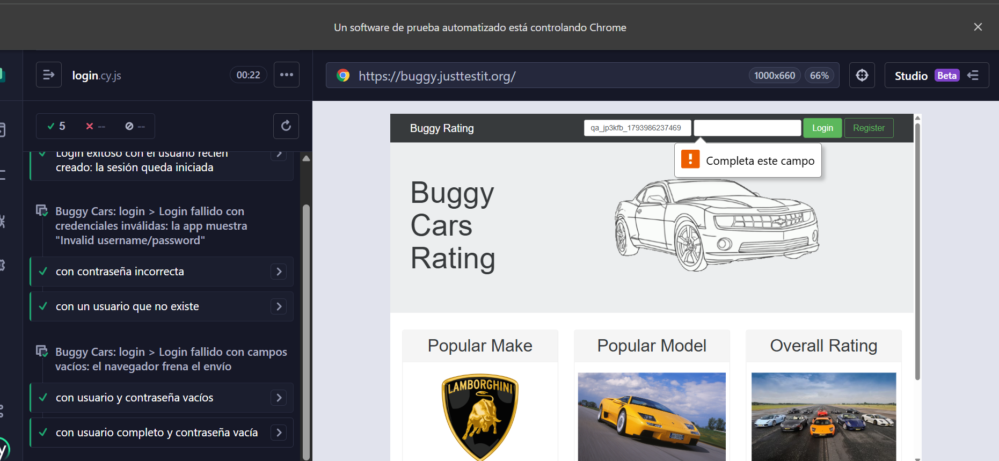
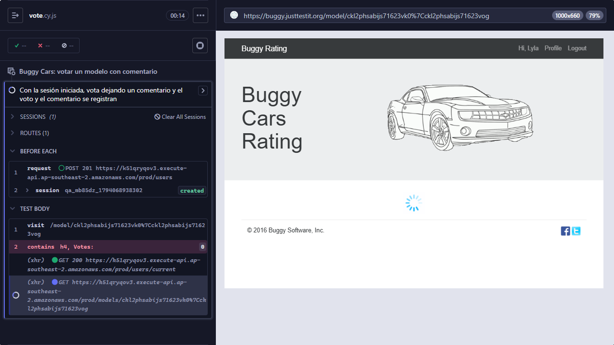

# Registro de fallas de tests

Acá quedan los tests que **fallaron por un problema del propio test** (no de la aplicación), cómo se investigó cada falla y cómo se corrigió. Sirve para distinguir un **defecto del sistema** de un **error en la prueba**, y para no repetir el mismo error.

> **Falso positivo** (ISTQB): el test reporta un defecto que no existe; el problema está en el test.
> **Falso negativo:** el test pasa aunque el defecto existe.

---

## F-01 — Login con campos vacíos: el test esperaba un mensaje que la app no muestra

| Campo             | Valor                                                                                                                          |
| ----------------- | ------------------------------------------------------------------------------------------------------------------------------ |
| **Fecha**         | 2026-11-06                                                                                                                     |
| **Test**          | `Buggy Cars: login › Login fallido... › con los campos vacíos` ([`cypress/e2e/ui/login.cy.js`](../cypress/e2e/ui/login.cy.js)) |
| **Sitio**         | https://buggy.justtestit.org/ (login del header)                                                                               |
| **Entorno**       | Cypress 16.2.1, navegador Electron (el de `cypress run`), Windows 11, PC local de pruebas                                      |
| **Clasificación** | **Falso positivo**: el test falló sin que la aplicación tenga un defecto                                                       |
| **Causa**         | La expectativa del test se escribió **sin haberla observado antes**                                                            |
| **Estado**        | ✅ Corregido: la suite de UI pasa 6 de 6 (ejecución local)                                                                     |

### 1. Qué esperaba el test (versión original)

Que, al hacer click en **Login** con usuario y contraseña vacíos, la app mostrara el aviso **"Invalid username/password"**, el mismo que aparece con credenciales incorrectas.

Esa expectativa era una **suposición**: el mensaje se había observado con una contraseña incorrecta y con un usuario inexistente, pero **nunca con los campos vacíos**. El caso estaba marcado como "no confirmado" antes de correrlo.

### 2. Qué pasó al ejecutarlo

Al correr `npm run test:ui`: **4 de 5 OK y 1 falla**, la de campos vacíos.

```
×  login.cy.js      4 tests   3 passing   1 failing
√  register.cy.js   1 test    1 passing
```

Error de Cypress:

```
expected Invalid username/password to be visible
```

### 3. Qué se observó en la evidencia

En la **captura automática** que Cypress guarda de cada test fallido (`cypress/screenshots/login.cy.js/...(failed).png`) se veía:

- Debajo del campo **Login** del header, el **globito del navegador** con el texto **"Completa este campo"**.
- **Ningún aviso de la app** ("Invalid username/password" no aparecía).
- En el log de Cypress, después del `click` **no había ningún request** `POST /oauth/token`: el formulario **no se llegó a enviar**.

(La captura automática de esa falla no se conservó: se borró al limpiar las salidas antes de volver a correr. El mismo comportamiento se ve en la captura de la sección 6).

### 4. Por qué pasa (análisis)

Los dos campos del login tienen el atributo HTML **`required`** (visto en el template de la app: `<input ngModel name="login" required ...>`). Con ese atributo, **el navegador mismo** bloquea el envío del formulario si el campo está vacío y muestra su mensaje nativo. La app nunca recibe el intento, así que **nunca puede mostrar** "Invalid username/password".

**Conclusión:** la aplicación se comporta de una forma válida (validación nativa del navegador). El que estaba mal era el **test**.

### 5. Cómo se corrigió

| Antes                                         | Después                                                                                                         |
| --------------------------------------------- | --------------------------------------------------------------------------------------------------------------- |
| Esperaba el texto "Invalid username/password" | Verifica que el navegador marque el campo como **obligatorio sin completar** (`validity.valueMissing === true`) |
| —                                             | Verifica que **no se envió** ningún request de login (`cy.get('@loginRequest.all')` con largo 0)                |
| —                                             | Verifica que la sesión **sigue sin iniciarse** (el formulario de login sigue visible)                           |
| 1 caso (ambos vacíos)                         | 2 casos: **ambos vacíos** y **usuario completo con contraseña vacía** (partición de equivalencia)               |

**Por qué NO se valida el texto "Completa este campo":** ese texto lo pone el **navegador según su idioma**. En la PC de pruebas está en español, pero el runner de GitHub Actions está en inglés ("Please fill out this field"). Validar el texto haría que el test pase en una PC y falle en el CI. `validity.valueMissing` es igual en cualquier idioma.

### 6. Resultado

Al volver a correr `npm run test:ui`: **6 de 6 OK**. También se verificó en el modo visual (`npx cypress open`, en Chrome):



_Captura (2026-11-06): test "con usuario completo y contraseña vacía" en verde. El usuario `qa_...` es un dato de prueba generado con Faker._

### 7. Lección aprendida

**La expectativa de un test sale de observar el sistema (o de su documentación), no de suponer.** Cuando no hay documentación, como en Buggy Cars, primero se observa el comportamiento y después se escribe la verificación. Al marcar el caso como "no confirmado" antes de correrlo, la falla se pudo identificar enseguida como un error del test y no como un bug.

**¿Es un bug de la app?** No. Como mucho es una **observación de UX**: el mensaje es el genérico del navegador, no uno propio de la app. Se menciona en ESTRATEGIA.md, no en BUGS.md.

---

## F-02 — Voto: el test esperaba la página con el tiempo por defecto (4 s) y la API tardó más

| Campo             | Valor                                                                                                                                          |
| ----------------- | ---------------------------------------------------------------------------------------------------------------------------------------------- |
| **Fecha**         | 2026-11-07                                                                                                                                     |
| **Test**          | `Buggy Cars: votar un modelo con comentario › Con la sesión iniciada, vota...` ([`cypress/e2e/ui/vote.cy.js`](../cypress/e2e/ui/vote.cy.js))   |
| **Sitio**         | https://buggy.justtestit.org/model/ckl2phsabijs71623vk0%7Cckl2phsabijs71623vog (Lamborghini Reventón)                                          |
| **Entorno**       | Cypress 16.2.1, navegador Electron (`cypress run`), Windows 11, PC local de pruebas                                                            |
| **Clasificación** | **Falso positivo**: el voto no llegó a probarse; falló la espera del test                                                                      |
| **Causa**         | El test buscaba "Votes:" con la espera por defecto de Cypress (4 s) en lugar de **esperar la respuesta** del request del modelo, que tardó más |
| **Estado**        | ✅ Corregido: la suite de UI pasa 8 de 8 (ejecución local)                                                                                     |

### 1. Qué hacía el test

Entraba a la página del modelo y buscaba el título **"Votes:"** para leer la cantidad de votos antes de votar. Cypress reintenta esa búsqueda durante **4 segundos** (`defaultCommandTimeout`) y, si no aparece, falla.

### 2. Qué pasó al ejecutarlo

Al correr `npm run test:ui`: **7 de 8 OK**; falló solo el voto.

```
√ login.cy.js   5 tests  5 passing
√ logout.cy.js  1 test   1 passing
√ register.cy.js 1 test  1 passing
× vote.cy.js    1 test   1 failing
```

### 3. Qué se observó en la evidencia

En la captura automática de Cypress:

- La **sesión estaba iniciada** (header "Hi, Lyla", Profile, Logout): el login por API + `cy.session` funcionó.
- La página del modelo seguía **cargando** (spinner).
- En el log, el request **`GET /models/...` seguía pendiente** cuando falló la búsqueda de "Votes:".



### 4. Por qué pasa (análisis con medición)

La API devuelve **todos los comentarios** del modelo en una sola respuesta, sin paginar. Medición del 2026-11-07 (desde el navegador, `GET /models/<id>`):

| Modelo                                     | Comentarios | Respuesta | Tiempo    |
| ------------------------------------------ | ----------- | --------- | --------- |
| Lamborghini Diablo                         | 3686        | 324 KB    | 4,4 s     |
| **Lamborghini Reventón** (modelo del test) | 2397        | 221 KB    | **4,3 s** |
| Lamborghini Aventador                      | 1789        | 177 KB    | 3,4 s     |
| Pagani Zonda                               | 857         | 88 KB     | 2,9 s     |
| Lancia Stratos                             | 178         | 17 KB     | 1,6 s     |

Cuantos más comentarios, más tarda. El Reventón supera los 4 s que esperaba el test.

### 5. Cómo se corrigió

| Antes                                             | Después                                                                                                                                                                                                                        |
| ------------------------------------------------- | ------------------------------------------------------------------------------------------------------------------------------------------------------------------------------------------------------------------------------ |
| Buscaba "Votes:" con la espera por defecto (4 s)  | `cy.intercept('GET', '**/models/*')` + **`cy.wait('@modelRequest')`** al cargar, después de votar y después de recargar: Cypress espera **la respuesta** (hasta 30 s por defecto) y sigue apenas llega. **Sin esperas fijas.** |
| Votaba el Lamborghini Reventón (2397 comentarios) | Vota el **Lancia Stratos** (178 comentarios): el test prueba el voto, no el rendimiento, y con menos datos hay menos ruido                                                                                                     |

### 6. Resultado

Al volver a correr `npm run test:ui` (2026-11-07): **8 de 8 OK** (login 5, logout 1, registro 1, voto 1).

### 7. Lección aprendida

**En una SPA, esperar el request que trae los datos, no el elemento con el tiempo por defecto.** El tiempo por defecto sirve para la UI, pero no para una API lenta. Y elegir los **datos de prueba** también es diseñar el test: un dato "pesado" agrega ruido a lo que se quiere verificar.

**¿Es un bug de la app?** No es un defecto funcional, pero sí una **observación de rendimiento** real: la página de un modelo descarga miles de comentarios sin paginar y tarda más de 4 s. Va a ESTRATEGIA.md (pruebas de performance).
